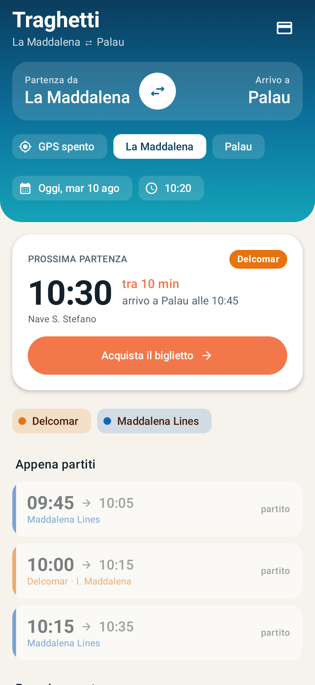
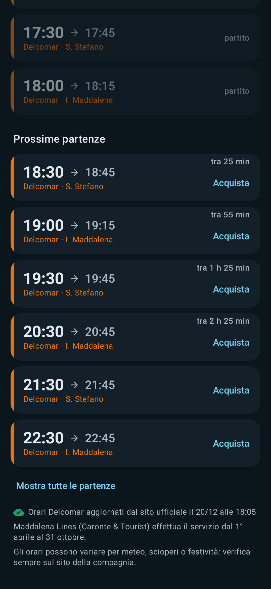
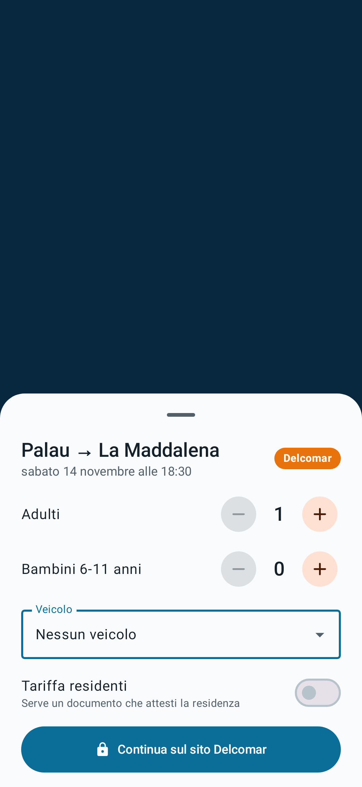
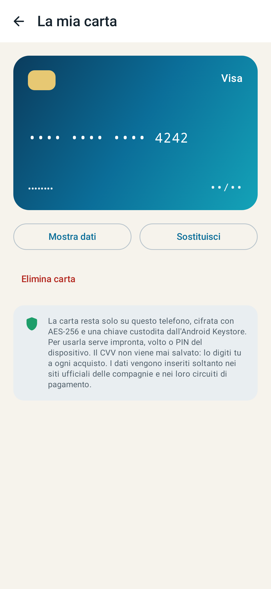

# Traghetti La Maddalena ⇄ Palau

App Android nativa (Kotlin + Jetpack Compose) con gli orari dei traghetti **Delcomar** e
**Maddalena Lines (Caronte & Tourist)** tra La Maddalena e Palau, e l'acquisto del biglietto
sui siti ufficiali delle compagnie senza uscire dall'app.

È la riscrittura della precedente versione .NET MAUI (ancora consultabile nella cronologia git).

| Orari | Tema scuro | Opzioni d'acquisto | Carta |
|---|---|---|---|
|  |  |  |  |

## Funzioni

- **Porto di partenza automatico via GPS** (porto più vicino) oppure scelta manuale / inversione tratta.
- **Prossima partenza** in evidenza con conto alla rovescia, **ultime 3 partite** (sbiadite) e
  **prossime 6**, con "Mostra tutte". Funziona anche a cavallo della mezzanotte.
- **Data e ora a scelta** con calendario e orologio Material 3, pulsante "Adesso".
- **Orari Delcomar aggiornati dal sito ufficiale** per il giorno scelto (nave inclusa), con cache
  su disco e orario incorporato come ripiego **offline**.
- **Orari Maddalena Lines stagionali** (servizio 1° aprile – 31 ottobre, tre fasce).
- Filtro per compagnia, tema chiaro/scuro, orari sempre nel fuso di Roma.
- **Acquisto del biglietto dentro l'app** sul sito della compagnia, già impostato su tratta, data,
  passeggeri, veicolo, tariffa e corsa; **carta di pagamento** custodita cifrata sul telefono.

Come funziona l'acquisto, i limiti e i risultati dei test: **[docs/REPORT.md](docs/REPORT.md)**.

## Compilare

Servono JDK 17+ e Android SDK (platform 35). Android minimo: 8.0 (API 26).

```bash
./gradlew assembleDebug
```

L'APK è in `app/build/outputs/apk/debug/app-debug.apk`.

## Test

```bash
./gradlew testDebugUnitTest
```

```bash
./gradlew testDebugUnitTest -PliveTests=true
```

Il secondo comando include il test che scarica davvero gli orari da `booking.delcomar.it`.
`./gradlew recordRoborazziDebug` rigenera le schermate in `docs/screenshots`.

Controllo in un vero Chromium degli script che l'app inietta nei siti (richiede Node e Playwright;
va eseguito dopo i test, che esportano gli script):

```bash
node tools/web-check/check.mjs
```

## Struttura

```
app/src/main/java/it/traghetti/maddalena/
  domain/    modelli e finestra "partiti / prossimi" (Kotlin puro)
  data/      orari incorporati, lettura del sito Delcomar, cache, repository
  location/  porto più vicino via LocationManager
  purchase/  deep link di prenotazione, domini fidati, script per la WebView
  card/      validazione carta, portafoglio cifrato (Android Keystore), biometria
  ui/        schermate Compose: home, acquisto, carta, tema
```

Gli orari possono variare per meteo, scioperi o festività: fa sempre fede il sito della compagnia.
App non ufficiale, non affiliata a Delcomar né a Caronte & Tourist.
